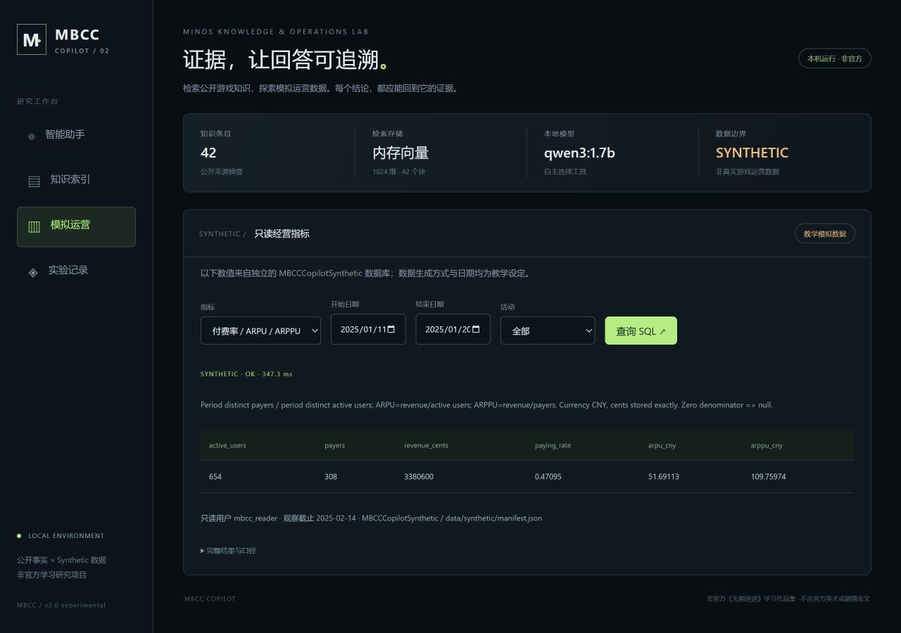

# MBCC Copilot 2.0

基于 Java 17、Spring Boot 3、LangChain4j、Ollama Qwen 的非官方《无期迷途》知识检索与模拟运营分析实验。**本机已运行，整体 PARTIAL：真实 SQL、内存 RAG 和自主工具链路可复验；Milvus 持久化仍 BLOCKED，Agent 仍有失败。** 不代表游戏开发商/发行商，不含官方美术、剧情全文或内部数据，应用仅本机运行；用户已授权将项目与证明材料上传GitHub。

## 能力与证据

**用于简历查证：[证明材料总索引](docs/proof-index.md) · [三条简历文案](docs/resume_evidence.md) · [80题原始评测报告](docs/evaluation_report.md)。**

| 阶段 | 状态 | 已实际运行的内容 / 边界 |
|---|---|---|
| A 模型与工具 | PARTIAL | 0.6B/1.7B/4B同20题真实比较；同1.7B单阶段/两阶段工作流另测，不能称稳定Agent |
| B RAG | PARTIAL | 官方短事实摘要、1024维真实Embedding、清洗/分块/过滤/Top-K/阈值；内存路径VERIFIED，Milvus写入重启BLOCKED |
| C SQL | PARTIAL | 独立MBCCCopilotSynthetic库，六类参数化只读查询、23项独立CSV对账；Gacha源工程未找到，使用明确标注的新Synthetic数据 |
| D 会话 | PARTIAL | 随机令牌隔离、磁盘历史、6轮/8000字符上限、30分钟TTL；模型上下文正确性以E2E原始结果为准 |
| E 评测 | PARTIAL | 80题冻结、A/B及补充内存C/D原始结果；正式Milvus C/D未执行 |
| F API/页面 | PARTIAL | 本机REST、深色演示页、实际SQL/工具/引用/延迟展示；真实截图与E2E另存 |
| G 部署 | PARTIAL | Java/Ollama/SQL混合运行、Compose和复验脚本；WSL启用后待Windows重启，Docker引擎/Milvus尚未验收 |

原版12条资料、代码、5项Mock和真实测试均保留。V2正式80题使用42条、9个官方URL的冻结知识快照；后续限定规则补充单独记录，不混入其指标。数据源索引见 [source-index.json](data/source-index.json)，每条含URL、公告日期、采集时间、版本标签、核查状态和摘要hash。角色异能档案不是完整战斗数值表，历史公告不代表当前版本。

## 启动

需要 Java 17/21、Maven、运行中的 Ollama、`qwen3:1.7b` 和 `qwen3-embedding:0.6b`。任务本机便携Java/Maven可由脚本发现；迁移时设置JAVA_HOME/MAVEN_HOME。

```powershell
.\scripts\build.ps1
.\scripts\run.ps1
# 可选真实SQL（先按部署文档配置ODBC/pyodbc和独立库）
.\scripts\run.ps1 -EnableSql -Python 'Python可执行文件完整路径'
```

访问 http://127.0.0.1:18081/。只监听本机。SQL未启用返回BLOCKED，不返回固定伪数据；Milvus显式启用后不可连接则失败，不静默回退。环境变量、数据库设置、Compose、独立测试与重启步骤见 [部署说明](docs/deployment.md)。不要把示例.env当作Spring自动加载配置。

## 架构

`官方短摘要 → 清洗/去重/结构分块 → Qwen3 Embedding → memory / 显式Milvus → 元数据过滤 + Top-K + 阈值 → 来源证据`。

`HTTP → 会话隔离 → AI Services自主选择工具 → 参数校验/六步上限 → 真实检索或只读SQL → 同模型证据综合 → 输出格式/引用/证据门禁 → 回答+审计`。

四个真实@Tool：searchCharacterKnowledge、searchGameMechanics、getGameEventInfo、queryGameMetrics。无关键词工具路由、无题库答案注入。关键词检索只用作独立对照组。六类SQL指标：DAU、PAYMENT、RETENTION_D1、RETENTION_D7、EVENT_REVENUE、EVENT_PARTICIPATION。金额用整数分；留存按注册cohort精确日计算并剔除观察期未成熟部分；零分母返回null。

SQL Server经固定Python ODBC桥接，仍属真实数据库执行；Java未使用JDBC。查询固定模板/绑定值，只接受指标枚举和过滤字段。mbcc_reader上下文SELECT-only且NO REVERT，但连接仍使用本机既有Windows身份，未配置生产级专用低权限登录。所有经营数字均为Synthetic；未修改WeatherSmart/Gacha/WideWorldImporters业务数据或仓库。

## API与演示

`/api/health`、`/api/chat`、`/api/knowledge/search`、`/api/characters`、`/api/events`、`/api/metrics/query`、`/api/evaluation/summary`，以及建立匿名会话的`POST /api/sessions`。聊天需要X-MBCC-Session-Token。旧`/api/agent`委托V2，旧源码/测试保留。详见 [API文档](docs/api.md)。

页面显示问题、结构化回答、实际召回来源、实际工具参数/结果、模型、请求耗时和Synthetic声明。模型失败时显示错误并允许查看未验证原始输出，不能把status=OK当作完全事实正确。



## 评测与交付索引

- [80题评测报告](docs/evaluation_report.md)：四组实际结果、Recall@5、工具参数、引用、无答案、延迟与评分边界。
- [模型与工作流对照](docs/tool_calling.md)：将模型升级与同模型架构比较分开。
- [失败分析](docs/failure_analysis.md)：前10个真实失败，原输出全部保留。
- [SQL口径与安全边界](docs/sql_metrics.md)、[RAG流程](docs/rag_pipeline.md)、[架构与会话](docs/architecture.md)。
- [简历证据](docs/resume_evidence.md)：仅可写已完成量化内容，Milvus不写成已部署。
- `evidence/v2/`：环境、模型逐题日志、SQL对账、评测原始记录、页面截图、安装阻塞与分项验收。
- [第一轮记录](docs/round-one.md)：历史证据，不作为V2最终状态。

Mock单元、真实LLM、数据库集成、HTTP端到端、80题独立评测分别统计，不把skip或结构通过混入“总准确率”。本项目由用户与AI协作开发；面试需能独立解释调用链、SQL口径、证据与失败边界。远程上传以GitHub实际提交记录为准；没有将应用部署到公网。
