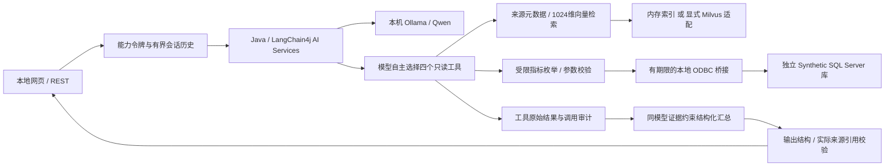

# MBCC Copilot 2.0 架构

这是在c0dd5ee上增量开发的Windows本机研究作品集，不是官方游戏服务。模型自主路由仍需按实测结果标PARTIAL，不能用编译成功代替Agent质量验收。

## 工程边界

- Java负责REST、LangChain4j工具循环、参数边界、向量检索、会话管理、输出校验与审计。
- Ollama接入既有服务，真实测试0.6B/1.7B/4B；最终默认1.7B。模型升级与同模型工作流对照分别记录。
- 为复用现有仅Windows认证的SQL实例且不改TCP/认证配置，指标执行采用Java启动本地Python ODBC桥接；SQL聚合仍在SQL Server中执行。没有冒充已实现JDBC专用只读登录。
- 所有值为绑定参数，模型不能提交SQL、表名或连接配置。
- Milvus为独立可选服务，默认内存状态显式标注。只有实际写入、查询、统计、重启、重新连接都通过后才验收持久化。
- 旧代码与测试保留；旧12条索引与V2索引分开。原固定Synthetic工具仅用于保留的旧版协议测试，公开新版Agent入口采用真实SQL工具。

## 两阶段工作流

小模型在同时要求工具选择与最终JSON时出现竞争，曾直接生成错误的现实世界答案。本轮先让AI Services执行自主工具循环，再由同一模型仅根据实际工具结果作schema约束汇总。没有应用关键词路由或固定工具选择。模型仍可能不调用、错选或误述，相关失败计入评测。

缺成功证据的肯定答案、无来源的知识答案、虚构引用和格式错误会被标为失败；reply置空，原始模型输出单独保留。失败文本不会写成会话事实。OK表示通过实现的结构/来源门禁，不表示已证明全部语义正确。

## 会话

每次创建独立随机sessionId及256位能力令牌，令牌哈希落盘，访问需对应令牌。最多6轮、8000字符历史，单轮也有长度限制；工具历史只保存状态摘要。闲置30分钟过期，每分钟清理，支持重新创建Store后恢复历史。

指代由模型根据真实历史理解，没有“她=赫卡蒂”规则。匿名能力令牌隔离不等同生产登录鉴权；已知令牌持有人可访问自己的会话。本地服务仅监听127.0.0.1。

## 评测和证据

Mock、数据库、真实模型、端到端API和独立80题实验分别统计。20题模型比较、同模型工作流比较和80题算法实验各保留配置及逐题输出；不把小样本结果当作总体准确率，也不把不同模型的差异归给架构。Milvus阻塞时C/D主实验不能冒充完成，内存补充实验另命名。
